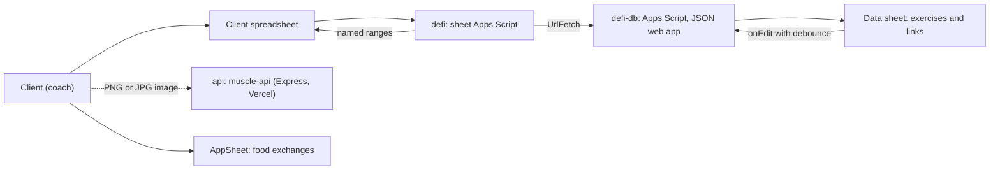
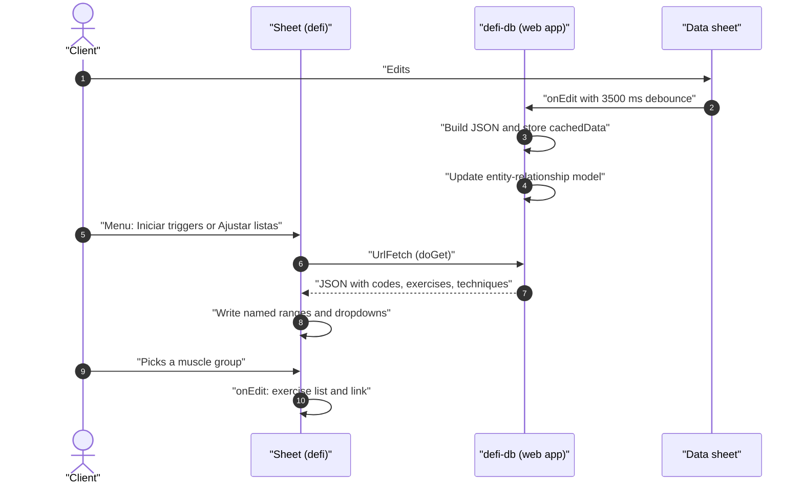
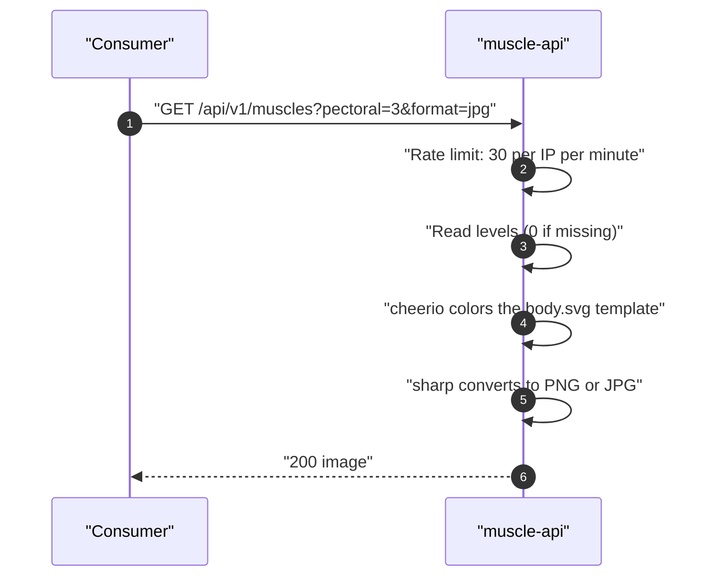

# DeFi architecture

English | [Español](./architecture.md)

## Context

The client's spreadsheet is the center. One Apps Script bound to the sheet holds the logic; another Apps Script, published as a web app, acts as the internal database. The Express API draws the muscle map and AppSheet calculates food exchanges.

## Main flow: loading data into the sheet

`defi` requests the JSON from `defi-db` and writes it into named ranges. The dependent dropdowns (muscle group, exercise, link) come from those ranges.

## Muscle map API flow

## Folders

| Path | Purpose |
| ---- | ------- |
| `defi/src/onOpen.ts`, `onEdit.ts` | Macro menu and edit handlers |
| `defi/src/config/` | Default configuration and generation of the configuration sheet |
| `defi/src/database/` | Reading the `defi-db` JSON and writing named ranges |
| `defi/src/sheet/` | Diet tables, exchanges, and shopping list |
| `defi/src/lib/`, `util/` | Triggers, document properties, dropdowns, and types |
| `defi-db/src/api/routes.ts` | `doGet`, debounced `onEdit`, and cache |
| `defi-db/src/lib/` | Data service, entity-relationship model, typed response |
| `api/src/` | Express server, controller, SVG template, and utilities |

## Key decisions

- **Apps Script as the internal database**: a web app that serves JSON and keeps a cache in `PropertiesService`, so the client's sheet reads data without an external database. The web app is anonymous-access and runs as the deploying user (`appsscript.json`); do not store sensitive data in that sheet.
- **TypeScript with clasp**: code is written and typed locally and pushed with `pnpm push`.
- **3500 ms debounce** on edit, so the JSON is not regenerated on every keystroke.
- **Separate API on Vercel** because Apps Script cannot convert SVG to an image; sharp and cheerio handle that behind a rate limit.
- **Historical changes**: the diet logic and the exchange system were disabled in the sheet; exchanges are calculated in AppSheet.
