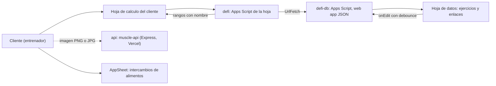
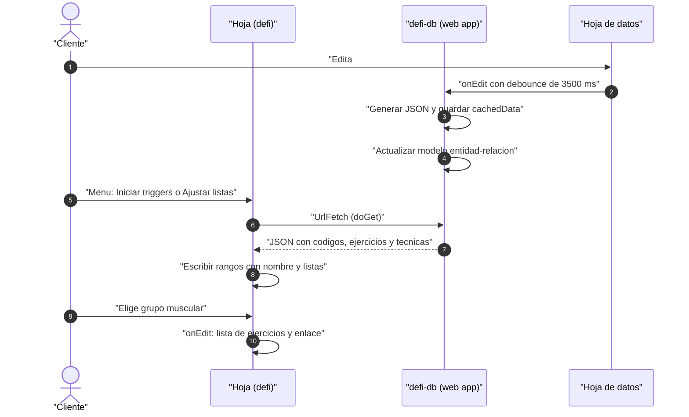
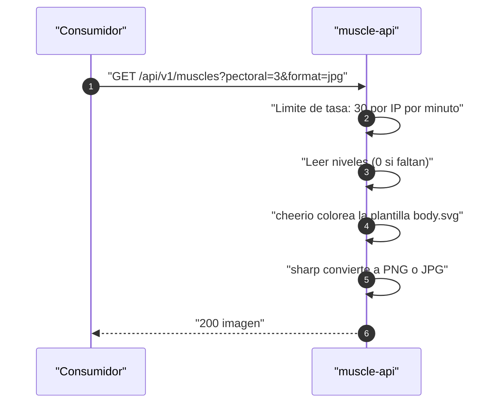

# Arquitectura de DeFi

[English](./architecture.en.md) | Español

## Contexto

La hoja de cálculo del cliente es el centro. Un Apps Script ligado a la hoja contiene la lógica; otro Apps Script, publicado como web app, hace de base de datos interna. La API Express dibuja el mapa muscular y AppSheet calcula intercambios de alimentos.

## Flujo principal: cargar datos en la hoja

`defi` pide el JSON a `defi-db` y lo escribe en rangos con nombre. Las listas dependientes (grupo muscular, ejercicio, enlace) salen de esos rangos.

## Flujo de la API de mapa muscular

## Carpetas

| Ruta | Propósito |
| ---- | --------- |
| `defi/src/onOpen.ts`, `onEdit.ts` | Menú de macros y manejadores de edición |
| `defi/src/config/` | Configuración por defecto y generación de la hoja de configuración |
| `defi/src/database/` | Lectura del JSON de `defi-db` y escritura en rangos con nombre |
| `defi/src/sheet/` | Tablas de dieta, intercambios y lista de compras |
| `defi/src/lib/`, `util/` | Triggers, propiedades del documento, listas desplegables y tipos |
| `defi-db/src/api/routes.ts` | `doGet`, `onEdit` con debounce y caché |
| `defi-db/src/lib/` | Servicio de datos, modelo entidad-relación, respuesta tipada |
| `api/src/` | Servidor Express, controlador, plantilla SVG y utilidades |

## Decisiones clave

- **Apps Script como base de datos interna**: una web app que sirve JSON y guarda una caché en `PropertiesService`, para que la hoja del cliente consulte los datos sin una base externa. El acceso de la web app es anónimo y se ejecuta como quien la despliega (`appsscript.json`); no guardes datos sensibles en esa hoja.
- **TypeScript con clasp**: el código se escribe y se tipa localmente y se sube con `pnpm push`.
- **Debounce de 3500 ms** al editar, para no regenerar el JSON en cada tecla.
- **API aparte en Vercel** porque Apps Script no convierte SVG a imagen; sharp y cheerio resuelven eso con un límite de tasa.
- **Cambios históricos**: la lógica de dieta y el sistema de intercambios se desactivaron en la hoja; los intercambios se calculan en AppSheet.
